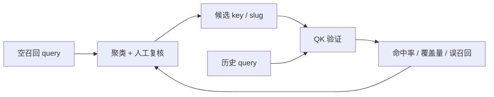

# QK 召回验证

聚类侧告诉我们“哪些空召回主题值得补 key”，这里负责验证：给一批候选 key（关键问 / 关键词），它们在历史 query 上到底能不能命中、能覆盖多少。

本目录包含验证工具、来源配置和本地数据；词表和取数结果不纳入 Git。

## 与聚类的关系



- 聚类产出主题和 `slug / keywords`，作为候选 key；
- 验证侧用历史 query 回放，检查这些 key 是否被召回；
- 结果回流到复核页，决定 key 是否保留、词表如何调整。

## 工具

| 文件 | 用途 |
|---|---|
| `src/qk_validation/match.py` | 单条 query 的节点打分与命中检查 |
| `src/qk_validation/table.py` | 词表 diff：新增/删除/改写的 key（含词表读取） |
| `src/qk_validation/relevance.py` | BM25 / 向量 / RRF 位次融合的本地实现 |
| `config/qk_config.json` | 来源与关键词阈值 |
| `data/` | 词表、基准快照、本地样本（不入 Git） |
| `temp/` | 临时调试脚本（不入 Git） |

词表 `data/qk_keys.json` 与旧版基准 `data/qk_corpus.json` 放在 `data/` 下，`qk_keys.json` 可以直接改。

## 准备词表

`data/qk_keys.json` 最小格式是一层 slug → 问句串：

```json
{
  "node_1": "问句一#问句二",
  "node_2": "问句三#问句四"
}
```

也可以把 `data/qk_corpus.json` 复制一份改名起步；用 `--keys` 可以指向别的路径。文件缺失或不是合法 JSON 时会直接报错退出。

## 使用

```powershell
# 在仓库根目录
uv run --project qk_validation python -m qk_validation.match "你的问题" --s 1
uv run --project qk_validation python -m qk_validation.table
uv run --project qk_validation python -m qk_validation.relevance --self-check
```

`--s` 可以写来源序号或名称，默认取 `config/qk_config.json` 的 `default_source`；阈值也在这里配置。

稠密向量默认走本机 Ollama 的 `bge-m3`；没有 Ollama 时会自动退回哈希占位向量（结果仅供相对比较），也可以显式加 `--embedding lite`。

本地取数脚本用 `.env` 里的连接信息；验证工具本身不读数据库。

## 说明

- 阈值是本地标定值，换数据后需要重新标定；
- 不承诺与线上系统逐位一致，关键词分是本地近似。
